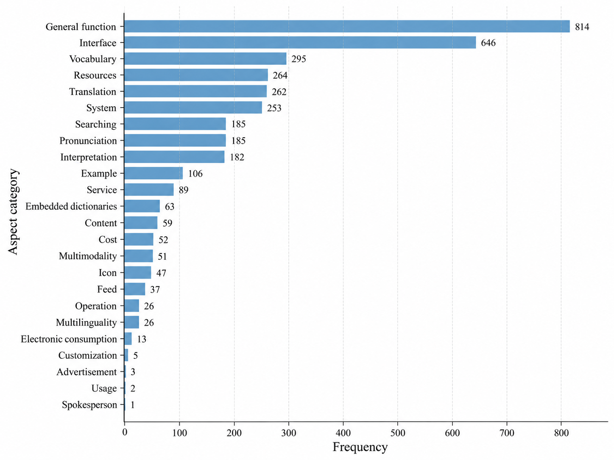

# SADAR: Sentiment Analysis of Chinese Dictionary App Reviews

**A domain-specific benchmark for aspect-based sentiment analysis (ABSA), lexicographic evaluation, and zero-shot large language model (LLM) assessment.**

SADAR accompanies the manuscript **“Mining E-dictionary App-store Reviews for Lexicographic Insight: The SADAR Benchmark Dataset and the Limits of LLMs.”** The study examines what Chinese-language app-store reviews reveal about users' expectations of English dictionary applications and how reliably LLMs can extract fine-grained sentiment information from those reviews.

> **Repository availability:** This README describes the research and its reported results. The annotation files, experimental code, model outputs, download instructions, licensing terms, and publication metadata must be added or confirmed by the repository maintainers before claiming that they are available here. The accompanying README starter package contains this document and the category-distribution figure; it is **not** the SADAR dataset release.

## Contents

- [Overview](#overview)
- [Dataset at a glance](#dataset-at-a-glance)
- [Data source and coverage](#data-source-and-coverage)
- [Annotation scheme](#annotation-scheme)
- [Category taxonomy](#category-taxonomy)
- [Research questions and benchmark tasks](#research-questions-and-benchmark-tasks)
- [Experimental setup](#experimental-setup)
- [Benchmark results](#benchmark-results)
- [Qualitative error analysis](#qualitative-error-analysis)
- [Data access and reproducibility](#data-access-and-reproducibility)
- [Recommended repository structure](#recommended-repository-structure)
- [Limitations and responsible use](#limitations-and-responsible-use)
- [Citation](#citation)
- [License and contact](#license-and-contact)

## Overview

Electronic dictionaries are no longer only collections of definitions. Users also evaluate them as mobile applications: they comment on interface design, search convenience, pronunciation, translation, supplementary learning resources, stability, pricing, and other aspects of the overall experience.

SADAR organizes this feedback as structured **aspect–category–opinion–sentiment (ACOS) quadruples**. It was developed to support two complementary lines of inquiry:

1. **Lexicographic insight:** What do app-store reviews reveal about the dimensions on which people evaluate online dictionaries?
2. **Computational benchmarking:** How effectively can zero-shot LLMs recover categories, aspects, sentiments, and complete ACOS quadruples from Chinese review text?

The work contributes a Chinese, dictionary-domain annotation resource; a 24-category interpretation framework; and an evaluation illustrating the limitations of zero-shot LLMs on relationship-sensitive extraction tasks.

## Dataset at a glance

| Item | Description |
| --- | --- |
| Dataset name | **SADAR** — Sentiment Analysis of Chinese Dictionary Apps Review |
| Domain | English dictionary mobile applications reviewed by Chinese-speaking users |
| Primary review language | Chinese |
| Reported dataset size | **3,008 annotated review sentences** |
| Applications covered | **5** |
| Final aspect categories | **24** |
| Annotation target | **Category, Aspect, Opinion, Polarity** (ACOS quadruple) |
| Polarity scheme | **1 = positive; 0 = negative or neutral** |
| Annotation workflow | Human annotation in spreadsheet sheets, following category and span guidelines |
| Reported agreement | Krippendorff's alpha **0.998**, assessed on **100 comments** |
| LLM evaluation | **4** zero-shot ABSA subtasks |
| Models considered | **10**; quantitative table reports **9** (Mixtral-8x7B was excluded; see below) |
| Metrics reported | Precision, recall, and F1 |

The manuscript's dataset-comparison table reports **1,751 positive** and **1,257 negative/non-positive** annotations under its two-way reporting scheme (total: 3,008). Since the study maps both negative and neutral sentiment to `0`, these figures should **not** be interpreted as three-class sentiment counts.

## Data source and coverage

The original reviews were collected from a third-party historical app-data service, [Damaishuju](https://www.damaishuju.com/), for five English dictionary applications used by Chinese-speaking learners:

| Application | Focus in this study |
| --- | --- |
| Oxford English–Chinese Dictionary | Bilingual lexical reference and dictionary content |
| Youdao Dictionary | Bilingual lookup, translation, vocabulary tools, and learning features |
| Collins English–Chinese Dictionary | Bilingual dictionary lookup and learner-oriented reference content |
| Kingsoft PowerWord | Dictionary resources, examples, pronunciation, and translation |
| Oulu Dictionary | Customizable dictionary content, lookup, and learning-oriented functionality |

The review text and annotations are Chinese-language research data. The paper does not specify in its narrative a public file URL, exact collection date interval, app-wise sample counts, or fixed train/development/test partitions; these details should be added from the actual release metadata rather than inferred.

## Annotation scheme

A review can mention **multiple targets** and therefore receive more than one ACOS quadruple. Each annotation contains four components:

| Component | Meaning | Example |
| --- | --- | --- |
| **Category** | Type of dictionary-app feature or experience being evaluated | `功能` (Function) |
| **Aspect** | The specific evaluated target or expression | `扫描功能` (scanning function) |
| **Opinion** | Text expressing the evaluation of that aspect | `很强大` (very powerful) |
| **Polarity** | Binary sentiment label | `1` (positive) |

### Illustrative annotated review

The example below reproduces the human annotation presented for **comment ID 48** in the study. Its JSON layout is for **documentation only**; the paper describes human annotation in spreadsheets, so do not assume this is the on-disk format of the eventual dataset release.

```json
{
  "comment_id": 48,
  "comment": "特别是扫描功能很强大",
  "human_absa": [
    ["功能", "扫描功能", "很强大", 1]
  ]
}
```

A corresponding negative/non-positive example, **comment ID 5**, includes `['界面', '大红色', '丑', 0]`: the reviewer criticizes the app's bright-red interface color.

**Interpretation of `0`:** This is a *non-positive* label combining negative and neutral sentiment, **not** a separately annotated neutral class. The human annotation procedure permits discussion of categories not covered by the initial taxonomy; the final SADAR inventory contains 24 categories.

## Category taxonomy

The study's final annotation inventory contains **24 categories**. These are distinct from the **23 second-level evaluation dimensions** listed in the earlier lexicographic framework used as a starting point in the manuscript's Appendix B.

| ID | Category | Chinese label | Interpretation |
| ---: | --- | --- | --- |
| 0 | Function | 功能 | Overall usefulness and practical app functions |
| 1 | Interface | 界面 | Visual design, layout, and appearance |
| 2 | Vocabulary | 词汇信息 | Range and quality of lexical information |
| 3 | Resources | 学习资源 | Additional learning materials and resources |
| 4 | Translation | 翻译 | Translation functionality and accuracy |
| 5 | System | 系统 | Technical performance, reliability, and updates |
| 6 | Searching | 检索 | Convenience, efficiency, and speed of lookup |
| 7 | Pronunciation | 发音 | Pronunciation and audio quality |
| 8 | Interpretation | 释义 | Accuracy and usefulness of definitions and explanations |
| 9 | Example | 例句 | Example sentences and their usefulness |
| 10 | Service | 服务 | Customer support and service quality |
| 11 | Embedded dictionaries | 内嵌词典 | Dictionaries integrated within the app |
| 12 | Content | 内容 | Overall richness and usefulness of content |
| 13 | Cost | 费用 | Pricing, fees, and value for money |
| 14 | Multimodal | 多模态 | Use of image, sound, and text together |
| 15 | Icon | 图标 | Design and attractiveness of the application icon |
| 16 | Feed | 推送 | Push notifications and daily feed content |
| 17 | Operation | 操作 | Smoothness and ease of app interaction |
| 18 | Language | 语种 | Language choices and multilingual support |
| 19 | Consumption | 耗电 | Battery and resource consumption |
| 20 | Customization | 自定义 | User-controlled personalization and settings |
| 21 | Advertisement | 广告 | Presence and impact of advertisements |
| 22 | Multi-function | 用途 | Versatility across uses and situations |
| 23 | Spokesperson | 代言人 | Evaluation of a spokesperson or celebrity endorser |

The manuscript provides full definitions and representative Chinese review examples for all 24 categories in **Appendix E**. The English display names used in some figures vary slightly (for example, *Language* / *Multilinguality* and *Consumption* / *Electronic consumption*); downstream data processing should use a single documented canonical label mapping.

### Category distribution



*Aspect-category frequencies reported in the paper. Counts are category frequencies, not necessarily unique-review counts, because a review may contain multiple evaluative targets.*

The most frequent categories were **Function (814)** and **Interface (646)**, followed by **Vocabulary (295)**, **Resources (264)**, **Translation (262)**, and **System (253)**. This distribution demonstrates that reviewers evaluate dictionary apps both as lexical reference tools and as general-purpose digital products.

## Research questions and benchmark tasks

The paper investigates two research questions:

- **RQ1:** What aspect categories of online dictionaries can be evaluated by users in application reviews?
- **RQ2:** How effectively do LLMs perform in fine-grained sentiment analysis?

To address RQ2, the experiments evaluate **four** progressively more demanding subtasks:

| Task | Required prediction | Illustrative target |
| --- | --- | --- |
| **1. Category extraction** | Identify applicable categories | `['功能']` |
| **2. Aspect extraction** | Extract explicit aspect terms | `['扫描功能']` |
| **3. Aspect-based sentiment classification** | Associate aspects with sentiment | `[['扫描功能', 1]]` |
| **4. ACOS quadruple extraction** | Recover linked category–aspect–opinion–polarity records | `[['功能', '扫描功能', '很强大', 1]]` |

*The targets above illustrate task intent, not literal outputs of every model or a guarantee of the serialized scoring format. See the exact released prompts and evaluation implementation for the authoritative interface.*

## Experimental setup

The paper uses **zero-shot prompting** and sets the generation **temperature to 0**. Local/open-weight models were accessed using **Ollama**, while API-accessed models were evaluated in a **Google Colab** environment. The model comparison considers:

**Local/open-weight models:** LLaMA 3.2, Qwen2-7B, Phi-3-14B, Mixtral-8x7B, and Yi-9B.

**API-accessed models:** Claude Sonnet 4.5, DeepSeek-V3, Gemini 2.0 Flash, GPT-4o mini, and GPT-5.2.

The results table refers to **LLaMA3.2-3B**; the exact LLaMA checkpoint should be confirmed against the executable experiment configuration before a fully reproducible release.

The manuscript reports **precision**, **recall**, and **F1** for each task. The precise evaluation scripts, text-normalization rules, handling of unmatched predictions, and any data partitions must be documented alongside the released code before claiming full numerical reproducibility.

## Benchmark results

**F1 scores reported in the manuscript's model comparison table:**

| Model | Category | Aspect | Aspect sentiment | ACOS quadruple |
| --- | ---: | ---: | ---: | ---: |
| LLaMA3.2-3B | 0.109 | 0.176 | 0.125 | 0.003 |
| Qwen2-7B | 0.275 | 0.236 | 0.224 | 0.007 |
| Yi-9B | 0.275 | 0.233 | 0.149 | 0.013 |
| Phi3-14B | 0.080 | 0.054 | 0.052 | 0.003 |
| Claude Sonnet 4.5 | 0.514 | 0.464 | **0.434** | **0.165** |
| DeepSeek-V3 | 0.517 | 0.428 | 0.386 | 0.126 |
| Gemini 2.0 Flash | 0.494 | **0.490** | **0.434** | 0.144 |
| GPT-4o mini | 0.464 | 0.391 | 0.349 | 0.073 |
| GPT-5.2 | **0.535** | 0.356 | 0.330 | 0.095 |

**Mixtral-8x7B is not shown**: the manuscript reports that it did not follow the requested instructions reliably and was excluded from the quantitative table rather than assigned an all-zero result.

### Main findings

- **Category extraction:** GPT-5.2 achieved the highest reported F1, **0.535**.
- **Aspect extraction:** Gemini 2.0 Flash achieved the highest reported F1, **0.490**.
- **Aspect-based sentiment classification:** Claude Sonnet 4.5 and Gemini 2.0 Flash tied at **0.434**.
- **ACOS quadruple extraction:** Claude Sonnet 4.5 achieved the highest reported F1, **0.165**.

The sharp decline for complete quadruple extraction indicates that detecting relevant terms is substantially easier than reconstructing all of their relationships correctly. These results should be understood as **zero-shot results in the specified dictionary-app review setting**, not as universal rankings of the evaluated models.

## Qualitative error analysis

The manuscript's Appendix F describes three recurring model failure modes:

| Failure mode | Example | Consequence |
| --- | --- | --- |
| **Empty predictions** | Mixtral-8x7B returned empty `first_task`, `second_task`, `third_task`, and `fourth_task` lists for comment ID 10. | Missing predictions and false negatives; this output can still be syntactically valid JSON. |
| **Over-labeling** | A LLaMA 3.2 response for comment ID 5 returned all 24 categories for a review about design and interface color. | False positives and reduced precision. |
| **Inconsistent structured output** | A LLaMA 3.2 response for comment ID 48 mixed textual `"positive"` with numerical polarity `1` and generated multiple category assignments. | Format inconsistencies and incorrect relations complicate automated scoring. |

The error analysis motivates stricter output schemas, validation, more selective category prediction, and investigation of domain adaptation or supervised methods.

## Data access and reproducibility

### Access to annotations and code

**To be completed by the repository maintainers:** Add the actual dataset filenames, download location, availability statement, data-use conditions, and code entry points here. Do not treat the illustrative JSON in this README as an exported dataset file or infer a train/test split not described in the manuscript.

### Reproducing the reported evaluation

Once the research files are released, a reproducible workflow should document how to:

1. Obtain the **authorized** annotated data and its data dictionary.
2. Use the **exact prompt versions** from the experiment, including the 24-category vocabulary and output schema.
3. Record **precise model IDs/checkpoints**, provider or Ollama versions, and any other generation settings (temperature was reported as `0`).
4. Generate and archive model outputs for the same evaluation examples.
5. Run the **released scoring implementation** to calculate precision, recall, and F1 under its specified matching and normalization rules.
6. Compare the resulting metrics with the nine reported model rows above, documenting any differences.

**No executable setup commands are provided here because the uploaded manuscript does not identify a verified `requirements.txt`, environment file, CLI interface, or runnable evaluation script.** Add tested commands after the corresponding files exist in the repository.

## Recommended repository structure

The following is a **suggested layout**, not a claim that the research files already exist. Rename folders to match the actual release:

```text
SADAR/
├── README.md
├── assets/
│   └── category_distribution.png      # Included with this README package
├── data/                               # Add only data authorized for distribution
├── taxonomy/                           # Category definitions and mappings
├── prompts/                            # Exact prompts used in the experiments
├── src/                                # Preprocessing, inference, and evaluation code
├── results/                            # Model outputs and evaluation summaries
└── paper/                              # Manuscript and supplementary materials
```

For a usable research release, the `data/` documentation should specify column types, review IDs, multi-quadruple representation, empty/missing-value conventions, encoding (UTF-8 recommended for Chinese), provenance, and available partitions. The `results/` documentation should state model versions and the metric definitions used.

## Limitations and responsible use

- **Domain specificity:** The benchmark covers five English dictionary apps and Chinese-language reviews; results should not be assumed to generalize unchanged to other app categories or languages.
- **Binary polarity:** The label `0` combines negative and neutral cases, so the released labels do not support a direct three-way sentiment evaluation without additional annotation.
- **Category imbalance:** A few high-frequency categories dominate the distribution, while some categories have very few examples.
- **Model and prompt dependence:** Scores depend on the tested checkpoints, prompts, zero-shot setting, and evaluation protocol.
- **Review provenance and privacy:** Publicly visible user reviews may still contain personal information or be subject to platform/service redistribution terms. Verify permissions, minimize personal identifiers, and document any access restrictions before releasing raw text.
- **Annotation reliability:** The manuscript reports alpha `0.998` on a 100-comment subset, but this should not be treated as a guarantee of error-free annotations throughout the corpus.

SADAR is intended for **research on fine-grained ABSA and user-centered lexicographic evaluation**. Avoid treating individual review predictions as definitive evidence about particular users or as a substitute for human review in consequential applications.

## Citation

If you use SADAR, please cite the accompanying manuscript. Its title in the supplied paper is:

> *Mining E-dictionary App-store Reviews for Lexicographic Insight: The SADAR Benchmark Dataset and the Limits of LLMs.*

**Citation metadata still needed:** Verified author list, publication status, venue/proceedings details, and DOI or persistent URL. The manuscript is formatted for AAAI 2026, but the provided PDF alone does not establish acceptance or publication.

A BibTeX **template** to complete after publication metadata is confirmed:

```bibtex
@misc{sadar_benchmark_2026,
  title = {Mining E-dictionary App-store Reviews for Lexicographic
           Insight: The SADAR Benchmark Dataset and the Limits of LLMs},
  author = {{REPLACE WITH VERIFIED AUTHOR LIST}},
  year = {2026},
  note = {Replace with verified venue, publication status, and URL/DOI}
}
```

## License and contact

**License:** **Not specified in the supplied manuscript.** The repository maintainers should add an appropriate `LICENSE` file and separate data-use terms if the source reviews and annotations have different redistribution conditions. **Do not infer that public GitHub hosting makes the underlying review text freely reusable.**

**Contact:** Add the corresponding author's verified contact details or use the repository's issue tracker after it is enabled. Please avoid posting private review information in public issues.

---

*This README documents the SADAR research described in the supplied manuscript. Repository links, distribution permissions, and reproducibility commands must be verified against the actual public release.*
